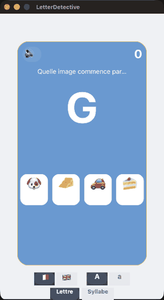

# LetterDetective

**"Which picture starts with this letter?" — a phonics game for kids.** A big letter appears;
tap the picture whose name starts with it. Built on [Hero](https://github.com/mesopelagique/Hero)
(`cs.hero`) for the animations.

## Play

Open the project — `On Startup` launches it.

- A big **letter** appears, with four pictures below.
- Tap the picture whose **name starts with that letter**.
- The correct word is revealed (e.g. `🍌 banane`), your **score** ticks up for a correct call,
  and the next round slides in with a fresh colour. A wrong call shakes the card and beeps —
  tap the **🔊** to mute.
- Two selectors at the bottom:
  - **Language** 🇫🇷 / 🇬🇧 — the picture names (and so the letter and the answer) switch between
    French and English.
  - **Case** A / a — the letter is shown upper- or lower-case.

Defaults: **Français** and **uppercase**. Built for early reading — pair a flag with a case and
go.

## How it's built

Every reaction is a `cs.hero` tween: the card colour lerps between rounds, the letter pops in
with `easeOutBack`, the score bounces, a wrong answer springs the card sideways with
`easeOutElastic`, and the ✓/✗ stamp scales in below the pictures. The next question is scheduled
with a delayed tween's `.then()` — no extra timer. The picture pads are laid out and centred at
runtime; the word list carries a French and English name for each of ~34 emojis.

## `cs.LetterDetective`

| Function | Action |
|:-|:-|
| `.newQuestion()` | Pick the target item, derive the letter from its name, choose three distractors, lay out the pictures. |
| `.choose($n)` | The player tapped picture `$n`: reveal the word, judge, score, feedback, then advance. |
| `.selectLang($i)` | Language — `1` = Français, else English (regenerates with the new word set). |
| `.selectCase($i)` | Letter case — `1` = A (upper), else a (lower). |
| `.toggleSound()` | Mute / unmute the wrong-answer beep. |
